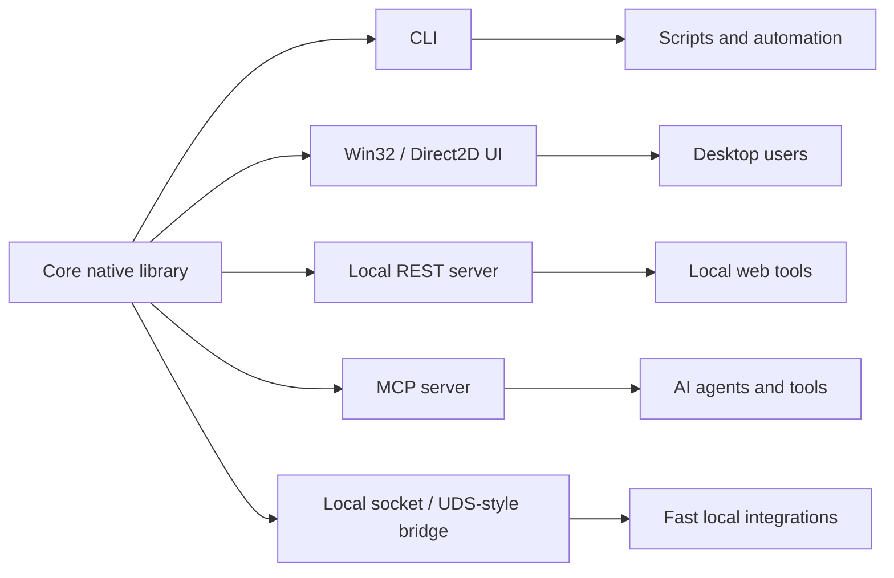
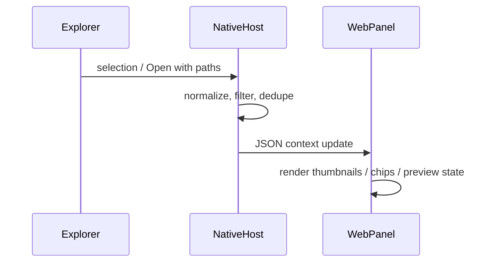
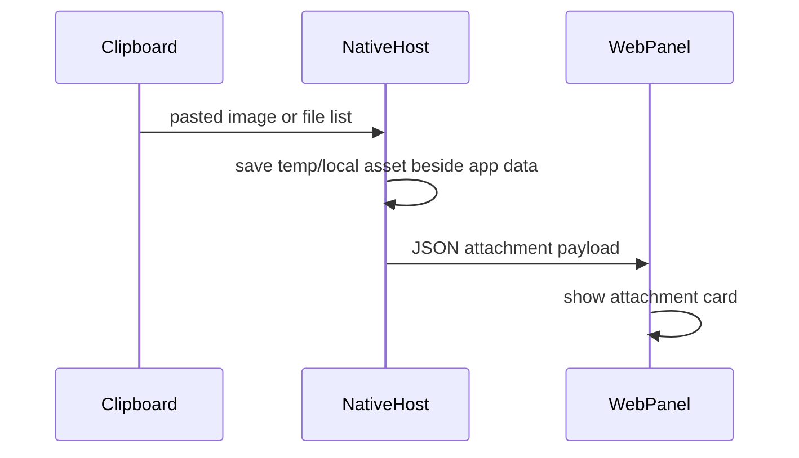
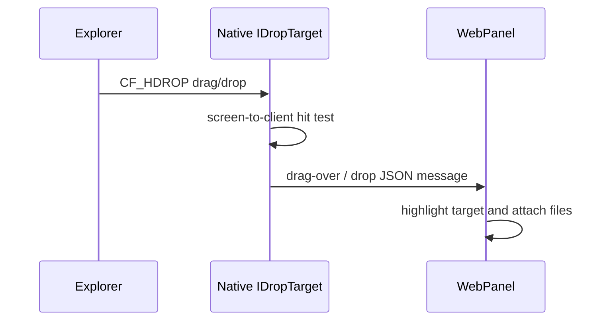
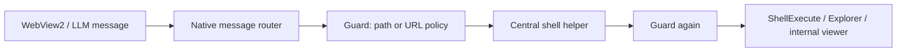

# Back to Win32

For years, the direction of desktop software felt obvious: move more of the app into the web stack, wrap it in Electron or WebView, share code with the browser, and let native APIs become someone else's problem. That path worked well enough for a lot of products. It made hiring easier, iteration faster, and cross-platform releases less painful.

But it also came with a cost that became harder to ignore. Every app started to feel like a small browser. Memory usage climbed, startup times slipped, and the desktop began losing the directness that made native software feel so good in the first place.

That is why Win32 still matters. This guide was prompted by [Windows Latest's report on Microsoft admitting that Windows 11 is still built on 90s-era Win32](https://www.windowslatest.com/2026/05/07/microsoft-admits-windows-11-is-still-built-on-90s-era-win32-and-no-one-saw-it-coming/): Win32 was never supposed to be the future in 2026, yet it remains the bedrock of Windows. It is fast, stable, deeply integrated, and close to the operating system in a way web-based shells can only approximate. Microsoft spent decades trying to replace it with newer frameworks, from WPF and Silverlight to WinRT, UWP, and WebView2-heavy applications. None of those attempts fully displaced the old API surface because the ecosystem built on top of Win32 was too useful to throw away.

Our own path has followed a similar curve. We came from web-based apps, then Electron and Node.js, chasing portability and developer velocity. Now we are returning to Win32 with a different perspective: not out of nostalgia, but because performance, integration, and control matter again.

This guide is a place to document that return. We will fill it with the practical lessons, frustrations, trade-offs, and wins that come from building native Windows software after years in the web stack.

## The Long Detour Through Windows UI Frameworks

Win32 survived partly because every successor arrived with a trade-off. MFC made native Windows development more approachable for C++ developers, but it carried the weight of its era: message maps, document/view patterns, and a style of programming that can feel distant from how modern applications are built. It was powerful, but it was never simple.

Then came the .NET wave. WinForms gave developers a productive way to build desktop tools quickly, and WPF brought XAML, data binding, composition, and a more modern rendering model. For many business apps, those frameworks were a huge step forward. But they also split the Windows world again: C++ on one side, managed code on another, native controls here, custom-rendered UI there, with different performance profiles and different long-term bets.

Microsoft kept searching for the next clean reset. Silverlight briefly promised a cross-platform XAML future. WinRT and the Windows 8 app model tried to turn Windows into a touch-first, sandboxed platform. UWP tried to unify phones, tablets, Xbox, and PCs. Each idea had something to offer, but each also asked developers to give up too much: existing code, low-level access, familiar distribution, or the trust that the platform would still matter in five years.

That vacuum helped Electron, Node.js, and WebView-based apps win developer attention. Web apps were rich, fast-moving, design-heavy, and familiar to large teams. Users became spoiled by that richness, even when it came fragmented across frameworks, design systems, and browser engines. Native Windows apps were no longer competing only with other Windows apps. They were competing with the entire web.

WinUI 3 and the Windows App SDK are Microsoft's latest attempt to reconnect modern UI with the Win32 base instead of pretending it can be replaced overnight. That direction makes sense, but it still leaves much to desire. Performance can be uneven, tooling can feel immature, documentation often trails reality, and the gap between what users expect from polished web interfaces and what native Windows UI gives developers out of the box is still very real.

So the return to Win32 is not a rejection of everything that came after it. It is a recognition that every layer above it has been a negotiation: speed versus abstraction, reach versus integration, visual richness versus memory cost, developer comfort versus user experience. The useful question is no longer which framework wins forever. It is which pieces let us build the Windows app we actually want.

## A Picture Gallery as a Reality Check

A basic picture gallery sounds simple: scan a folder, show thumbnails, open images quickly, remember view state, maybe support drag-and-drop, keyboard shortcuts, metadata, and a few editing actions. It is exactly the kind of app where framework choices become visible. The UI is not complex enough to justify a huge runtime, but users still expect it to feel polished, instant, and safe.

The numbers below are not formal benchmarks. They are practical example ranges from the kind of app we are talking about: an Electron-style gallery can easily take 5-20 seconds to feel ready on a cold start, a Win32-hosted WebView version can ship around 5 MB and open in roughly 2 seconds, while a minimal Win32 and Direct2D version can be around 2 MB and show its first window in roughly 300 ms.

| Approach | Typical app size | Launch feel | Runtime speed | Security surface | Where it shines | Where it hurts |
| --- | --- | --- | --- | --- | --- | --- |
| Browser-based web app | Small client, heavy server/runtime dependency | Fast if already loaded, poor as a local desktop tool | Depends heavily on network, browser cache, and server design | Exposed to browser, network, auth, storage, and dependency issues | Rich UI, easy updates, cross-platform reach | Weak local file integration, offline limitations, browser permission friction |
| Electron + Node.js | Often 100 MB+ before app content | Often 5-20 seconds before it feels ready on cold start | Good for UI, but memory pressure and IPC can hurt large folders | Chromium, Node.js, native modules, npm supply chain, IPC boundaries | Web developer speed, rich UI, shared frontend code | High memory use, large installers, complex attack surface |
| Win32 + WebView2 combo | Around 5 MB when relying on the installed WebView2 runtime | Around 2 seconds to open in a practical small app | Good if native code owns scanning, IO, and heavy work | Web content risks plus the host bridge boundary | Keeps a web UI while using native code for platform work | Still needs careful IPC design and browser runtime updates |
| WebView2 shell | Smaller than Electron if Edge runtime is present | Good when the runtime is warm | Similar to web, with native help available for hot paths | Web content risks, host bridge risks, browser engine dependency | Easier Windows integration than pure web, lighter than shipping Chromium | Still inherits web app complexity and browser-like memory behavior |
| WinForms | Small to medium, depends on .NET runtime and publishing mode | Generally quick, especially for tool-style apps | Fast enough for many tools, weaker for rich animated interfaces | Managed runtime plus native interop where used | Very productive for classic desktop utilities | Dated visuals, limited modern UI expectations |
| WPF | Medium, larger with self-contained .NET builds | Good, but can feel heavy with complex XAML | Can be smooth, but binding, templates, and layout can become expensive | Managed runtime, binding surface, plugins and interop | Data binding, custom UI, mature desktop patterns | Styling complexity, uneven performance if overused |
| UWP / WinRT | Controlled package size, runtime provided by Windows | Smooth when inside its intended model | Good within the sandbox, less flexible for custom native pipelines | Strong sandbox, app container restrictions | Store-style apps, permissions, safer distribution | Too restrictive for many real desktop tools |
| WinUI 3 / Windows App SDK | Medium to large depending on packaging | Improving, but still inconsistent | Promising, but still prone to framework overhead and surprises | Native plus framework/runtime dependencies | Modern Fluent UI with access to Win32 capabilities | Tooling friction, deployment complexity, performance surprises |
| MFC / classic Win32 C++ | Very small when carefully built; a minimal Win32 and Direct2D app can be around 2 MB | Can show a first window in roughly 300 ms | Excellent when written carefully, especially for file IO and native drawing | Mostly the app's own native code and Windows APIs | Speed, low memory, deep OS integration | More manual work, older patterns, easy to build ugly UI |

For a picture gallery, the user notices the basics immediately. Does it open before they lose patience? Does it scroll thousands of thumbnails without stutter? Does it decode large images without freezing the UI? Does it remember folders without asking strange permission questions? Does double-clicking a file feel native? Does the app sit quietly in memory, or does it behave like another browser tab?

This is where our expectations have changed. Web apps taught users to expect rich layouts, fluid animations, instant search, responsive resizing, and beautiful empty states. But web apps also normalized huge dependency trees, runtime duplication, background services, and frequent security patches for code that should have been a simple local tool. A native Windows gallery should try to keep the richness without accepting all of the weight.

## Why It Matters

The case for Win32 is not only about speed. Speed is the easiest thing to feel, but the deeper value is that a native app belongs to the operating system instead of hovering above it.

### Files Are Not Uploads

Direct file system access matters. A gallery should open folders, watch changes, read metadata, create thumbnails, accept drops from Explorer, and use normal file dialogs. No fake upload flow, no browser permission dance.

### Explorer Is Part of the App

Explorer integration matters too. File associations, previews, thumbnails, properties, jump lists, clipboard formats, drag-and-drop, advanced context menus, and "Open with..." are not extras. They are how Windows users move through their files.

### Small Apps Travel Further

Size matters because it lowers the barrier. A 2 MB or 5 MB app can be downloaded quickly, kept next to the files it works on, and used on old, cheap, shared, or bandwidth-limited machines. Smaller software supports more people than just those on new hardware and fast networks.

### Familiar Is a Feature

Interface familiarity matters. Win32 can look dated, but with careful layout, Direct2D drawing, good icons, dark mode, DPI awareness, and restrained custom controls, it can still look modern. Better yet, most Windows users already understand menus, dialogs, right-clicks, shortcuts, lists, tabs, and normal window behavior.

### Offline Liberty

Offline liberty matters. Local tools should work wherever the files are: on a laptop, an external drive, a workshop PC, a field machine, or a folder with no internet connection. Use the tool where you need it, next to your files, without a server, login screen, CDN, browser update, or expired token getting in the way.

### Fewer Moving Parts

Privacy and maintenance matter. A local gallery does not need to phone home to render thumbnails, and a small native stack has fewer moving parts than a web runtime, Node.js dependency tree, bundler, browser engine, IPC bridge, and native host.

### LLMs Change the Trade-Off

Win32 is verbose, but it is also old in the best possible way: the problems are known, the patterns are stable, and the examples are everywhere. Modern LLMs are unusually helpful here. They can explain message loops, COM setup, shell verbs, DPI scaling, dark-mode workarounds, CMake targets, and Direct2D boilerplate quickly enough that the old pain points become less blocking. That makes feature-rich native apps more realistic again without inventing a new framework.

### Not Perfect, Still Worth It

The goal is not to pretend Win32 is perfect. It is manual, sharp-edged, and sometimes poorly documented by modern standards. But for a focused desktop app, those trade-offs may be better than paying for a whole browser just to show files already on the user's disk.

## Practical Architecture

The architecture we want is simple: keep the real work in a small native library, then expose it through the surfaces that make sense for different users and workflows.

The point is not to make every app ship every surface. The point is to avoid putting business logic inside the UI. A picture scanner, thumbnail cache, metadata reader, image transform, or search index should live in the core library first. The UI becomes one client of that library, not the whole application.

From there, each surface has a role. The CLI is for scripting and batch work. The Win32 UI is for normal desktop use. A local REST server can help web tools or dashboards talk to the app without becoming the app. An MCP server can expose the same capabilities to agents. A local socket or UDS-style bridge gives us a fast path for trusted local integrations.

We will dive into a few of these in later sections, especially where the design changes how the app feels: startup time, file access, thumbnail generation, shell integration, automation, and local-first workflows.

Code examples: [architecture and layering](./win-guide-examples-architecture.md).

## How: Choose Libraries by Layer

The practical shape is simple: use [CMake](https://cmake.org/) to define ownership, keep the core native, then pick small libraries for each surface instead of letting one framework own the whole product.

### Build Layer

[CMake](https://cmake.org/) is the boundary map. A good setup has a core library target, one or more executable targets, and optional Windows-only targets for shell integration. Feature flags should add sources deliberately instead of spreading `#ifdef` decisions through the whole codebase.

Good choices here are plain CMake targets, [`FetchContent`](https://cmake.org/cmake/help/latest/module/FetchContent.html) for small vendored dependencies, and explicit runtime output folders. The build should make it obvious which code is core, which code is CLI, which code is UI, and which code is platform-specific.

Code examples: [CMake target boundaries](./win-guide-examples-architecture.md).

### Core Processing

The core library should own the real work: file scanning, image decoding, resizing, metadata, thumbnail generation, caching, search, and path handling.

For image-heavy tools, [libvips](https://www.libvips.org/) is a strong default because it is fast, memory-efficient, and built for large images. [Windows Imaging Component](https://learn.microsoft.com/en-us/windows/win32/wic/-wic-about-windows-imaging-codec) can cover native decode/encode paths when the goal is tight Windows integration. [libcurl](https://curl.se/libcurl/) is useful when URL inputs are needed. [nlohmann/json](https://github.com/nlohmann/json) is practical for configuration, API payloads, and local state. [spdlog](https://github.com/gabime/spdlog) deserves a real place too: native apps need startup timing, diagnostics, UI-event tracing, and file logs because debugging Explorer launches, shell extensions, and GUI startup paths is otherwise painful. Small helpers like [PicoSHA2](https://github.com/okdshin/PicoSHA2), globbing, [toml++](https://github.com/marzer/tomlplusplus), [dotenv-cpp](https://github.com/laserpants/dotenv-cpp), or [Kainjow Mustache](https://github.com/kainjow/Mustache) are fine when they stay below the core API instead of becoming the architecture.

Practical takeaway: core APIs should be plain structs and functions. If they can be called without a window, browser, server, or command parser, they belong here.

Code examples: [core API shape](./win-guide-examples-architecture.md) and [startup logging](./win-guide-examples-cli-logging.md).

### CLI Layer

The CLI is the first real client of the core library. It gives every feature a scriptable path, makes testing easier, and gives power users a tool they can run beside their files.

[CLI11](https://github.com/CLIUtils/CLI11) is a good fit for C++ command trees: subcommands, validation, defaults, and readable help text without building a parser by hand. On Windows, prefer a wide-character entrypoint (`wWinMain` or `wmain`) and convert paths to UTF-8 once at the edge. Console attachment should be deliberate so Explorer launches do not open a random terminal, while scripted launches still get stdout and stderr.

Practical takeaway: if a feature cannot be driven from the CLI, it is probably too tightly coupled to the UI.

Code examples: [Windows entrypoint into shared CLI logic](./win-guide-examples-architecture.md) and [CLI registration with logging](./win-guide-examples-cli-logging.md).

### Win32 UI Layer

The UI layer should orchestrate, not own the product. It gathers paths, shows progress, previews files, routes commands, and calls the core library for actual work.

For native Windows UI, the baseline choices are still valuable: [Win32 windows and messages](https://learn.microsoft.com/en-us/windows/win32/learnwin32/window-messages), [COM](https://learn.microsoft.com/en-us/windows/win32/com/component-object-model--com--portal) initialization, [common dialogs](https://learn.microsoft.com/en-us/windows/win32/shell/common-file-dialog), [Shell APIs](https://learn.microsoft.com/en-us/windows/win32/shell/shell-entry), [Direct2D](https://learn.microsoft.com/en-us/windows/win32/direct2d/direct2d-portal) for custom drawing, [DirectWrite](https://learn.microsoft.com/en-us/windows/win32/directwrite/direct-write-portal) for text, [WIC](https://learn.microsoft.com/en-us/windows/win32/wic/-wic-lh) for image decode/encode, [GDI](https://learn.microsoft.com/en-us/windows/win32/gdi/windows-gdi) / [GDI+](https://learn.microsoft.com/en-us/windows/win32/gdiplus/-gdiplus-gdi-start) where they are still the simplest answer, and [DWM](https://learn.microsoft.com/en-us/windows/win32/dwm/dwm-overview) for window chrome hints. [WebView2](https://developer.microsoft.com/en-us/microsoft-edge/webview2/) can be useful for rich panels, but it works best as one hosted surface, not as the whole app.

Native controls are not always the final answer. The [Windows Ribbon framework](https://learn.microsoft.com/en-us/windows/win32/windowsribbon/windowsribbon-entry) is a good example: it is fast and looks sharp even on HiDPI screens, but styling is limited, the XML workflow is annoying, and small visual changes can become framework fights. Replacing that kind of rigid surface with owner-drawn controls, [ThorVG](https://www.thorvg.org/)-style SVG rendering, and [Tabler Icons](https://tabler.io/icons) gives more control over color, spacing, state, and density.

[Dark mode](https://learn.microsoft.com/en-us/windows/apps/desktop/modernize/ui/apply-windows-themes) is another reminder that Win32 is powerful but not automatic. It is not one switch. The app often has to opt into dark title bars through DWM, allow dark mode across the HWND tree, push the right `SetWindowTheme` values into standard controls, refresh list view colors separately, and avoid styles such as `WS_EX_CLIENTEDGE` when they force light borders or light edit backgrounds. Some shell-hosted controls should be left alone because they already follow the OS and can break when themed recursively.

Small rendering tricks matter here. Menus, rebars, status bars, dock tabs, and ribbon backgrounds may need to be filled with a palette derived from the OS theme so they blend into the rest of the window. Skipping background erase during dark refreshes can avoid white flashes. For settings panels, even control factories matter: DPI-scaled geometry, no unnecessary client edge, and explicit background treatment can be the difference between a native-looking panel and a patchwork of light rectangles.

[Direct2D](https://learn.microsoft.com/en-us/windows/win32/direct2d/direct2d-portal) is also worth taking seriously. Early experiments show that it covers the places where [GDI](https://learn.microsoft.com/en-us/windows/win32/gdi/windows-gdi) starts to feel old: glow, soft shadows, animated transitions, smooth scaling, and high-quality custom widgets. GDI is still useful for simple text and controls, but it is not where modern visual polish should stop.

The UI itself does not need to be complicated, but the layout does need to be flexible. Docking frameworks such as [Win32++](https://github.com/Win32-WTL/Win32xx) can turn a simple native app into a real workspace: file tree on the left, queue at the bottom, log and settings as dockable panels, chat or preview in the centre. The trick is to keep docking as a visible workspace feature, not as a startup tax. Hidden panels should be logical state, not live HWNDs created during boot, and workbench defaults should own their own panel anchors.

Practical takeaway: start with standard windows and controls where they fit. Use custom drawing where it creates visible value, especially for icons, toolbars, previews, animation, and dense app chrome.

Docs and examples: [lazy layout notes](../lazy-layout.md), [dockers layout notes](../dockers-layout.md), and [Win32 UI theming, controls, and dock layout](./win-guide-examples-win32-ui.md).

### WebView2 Layer

After avoiding web wrappers for the main app, [WebView2](https://developer.microsoft.com/en-us/microsoft-edge/webview2/) can still be the right answer for specific surfaces. A rich chat interface is the obvious example: links, thumbnails, markdown, code blocks, animations, paste handling, model status, tool calls, and responsive layout are exactly where React and CSS are strongest. Rebuilding all of that in owner-drawn Win32 would be possible, but not a good use of time.

The important distinction is scope. WebView2 should be a panel, not the platform. In a hybrid app, the native host still owns files, settings, shell integration, windowing, job control, and heavy work. The web layer owns the rich interaction surface. With a small bundled React app, load time can be acceptable; in our case around 100 ms for the web app itself is good enough for a chat panel or advanced viewer.

The practical details matter. Give WebView2 its own app user-data folder so it does not pollute the user's browser profile. Prefer a stable virtual host mapping over `NavigateToString()` when the page needs `localStorage`, because an opaque origin will not behave like a normal first-party app. Drive `prefers-color-scheme` from the same app theme as the native UI, set the controller background color to match the host surface, and resync the chrome after creation to avoid bright fringes around the embedded browser.

Communication should stay boring and explicit. Use JSON messages between the web UI and the native host. Keep all WebView2 calls on the UI thread; worker threads should post back to the host window before executing script or sending messages. For cold starts, expect that React may not have installed its bridge object yet, so replay initial state after navigation completes.

Shell integration needs extra care. Browser drag-and-drop is not the same as Explorer drag-and-drop. For real file drops, a host-side `IDropTarget` that reads `CF_HDROP` can catch cases where the DOM `DataTransfer.files` path is empty, then forward clean JSON to the web UI. The same pattern works for viewer panels: native code resolves files, folders, permissions, and local mappings; the web panel renders the difficult view.

Brief example flows:

Practical takeaway: WebView2 is a good escape hatch for rich panels, especially chat and complex viewers. It becomes a problem when it replaces the native app instead of complementing it.

Code examples: [WebView2 host, theme, storage, and drag-drop bridge](./win-guide-examples-webview2.md).

### REST Layer

A local REST server is useful when browser tools, dashboards, scripts, or other local processes need to call the same core features. It should stay local by default unless there is a real network product behind it.

[cpp-httplib](https://github.com/yhirose/cpp-httplib) is a practical small-server choice for C++ apps. Pair it with [nlohmann/json](https://github.com/nlohmann/json) for request and response bodies, and keep handlers thin: parse input, call the core library, return structured results.

Practical takeaway: REST is a surface, not a second implementation. Do not duplicate image logic in HTTP handlers.

Code examples: [REST and service routes](./win-guide-examples-services.md).

### Auth Layer

Authentication is not just a web-app problem. A native Windows app can still use a modern hosted identity provider such as [ZITADEL](https://zitadel.com/) with the same account system as the web product. The practical pattern is OAuth authorization code with PKCE: start a short-lived loopback listener on `127.0.0.1`, open the system browser for the login UI, receive the callback locally, exchange the code, and store tokens beside the app settings.

This keeps the sensitive login ceremony in the user's browser instead of embedding credentials in a custom native form. It also means the CLI, Win32 menu, and service upload paths can share the same auth flow. From the user's point of view it feels like a normal browser login; from the app's point of view it is just another local service surface.

Practical takeaway: browser-based auth is not a surrender to web apps. It is often the cleanest way for native tools to use modern identity without owning passwords.

Docs and examples: [ZITADEL sign-in notes](../zitadel.md) and [native auth snippets](./win-guide-examples-services.md).

### MCP Layer

[MCP](https://modelcontextprotocol.io/) is another surface over the same core library. It makes local tools visible to agents without making the agent scrape the UI or shell out blindly.

The useful pattern is to expose narrow tools: resize this image, inspect metadata, find matching files, create thumbnails, transform a selected image, or list supported operations. Use JSON schemas and predictable error messages. Keep dangerous operations explicit, especially anything that writes files.

Practical takeaway: MCP tools should feel like CLI commands with structured inputs and outputs.

Code examples: [MCP tool routes](./win-guide-examples-services.md).

### Local IPC Layer

Some integrations need less overhead than REST. A local bridge can use [named pipes](https://learn.microsoft.com/en-us/windows/win32/ipc/named-pipes) on Windows, [Unix domain sockets](https://man7.org/linux/man-pages/man7/unix.7.html) on Unix-like systems, loopback TCP, or an [Asio](https://think-async.com/Asio/) based abstraction if portability matters.

This layer is useful for single-instance apps, fast local automation, queue control, progress streaming, and trusted companion processes. It should be boring: length-prefixed JSON, JSON lines, or another simple protocol that is easy to debug.

Practical takeaway: choose the simplest transport that matches the trust boundary. Local-only IPC should not accidentally become a remote API.

Code examples: [local service patterns](./win-guide-examples-services.md).

### Shell Integration

This is where Win32 earns its keep. File associations, `Open with...`, drag-and-drop, previews, thumbnails, property handlers, and context menus make the app feel like part of Windows.

For modern context menus, [`IExplorerCommand`](https://learn.microsoft.com/en-us/windows/win32/api/shobjidl_core/nn-shobjidl_core-iexplorercommand) / [`IExecuteCommand`](https://learn.microsoft.com/en-us/windows/win32/api/shobjidl_core/nn-shobjidl_core-iexecutecommand) style COM integration is the serious path. For simpler cases, [file associations](https://learn.microsoft.com/en-us/windows/win32/shell/fa-file-types) and command-line verbs may be enough. Either way, the shell integration should pass paths into the same CLI/core entrypoints instead of creating a separate code path.

Practical takeaway: Explorer integration is product surface. Treat it with the same care as the main window.

Code examples: [Explorer and shell integration](./win-guide-examples-shell.md).

## Security

Native power cuts both ways. Direct file access, shell verbs, WebView2 bridges, MCP tools, and LLM-driven actions are exactly why the app feels useful, but they are also the places where a mistake can become an OS-level problem.

The first rule is simple: never let web or LLM content touch the shell directly. A click inside a chat transcript should not become `ShellExecuteW` just because it contains a path. A model response should not be able to open `C:\Users\...\AppData`, read browser stores, launch a script, or select a sensitive folder in Explorer. Treat every path or URL that comes from the web panel, an agent, or generated content as hostile until a native guard has accepted it.

The useful pattern is two-layered:

The first guard rejects bad messages early. The second guard lives in the central shell/helper layer and runs even if a future call site bypasses the first one. That defense-in-depth matters because native apps grow many entrypoints over time: context menus, chat links, viewer clicks, drag-and-drop, REST, MCP, IPC, and CLI commands.

For paths, use a shared filesystem guard. The `llm_fs_guard` pattern is a good baseline: canonicalize when possible, reject dot-named paths, reject platform-hidden files, block known sensitive prefixes, and apply stricter rules for writes. Write operations should not be allowed to create scripts, installers, archives, Office/PDF payloads, or outputs under protected system locations. For a media app, a narrow allowlist for image, video, and audio outputs is easier to reason about than a giant denylist.

For URLs, only allow the schemes you actually need. `http` and `https` are enough for normal external links. Block `file:`, `javascript:`, `data:`, custom app schemes, userinfo, null bytes, huge URLs, private IPs, loopback hosts, and obfuscated numeric hosts. This prevents a generated link from becoming a local-file read, credential trick, or SSRF-style probe into services running on the user's machine.

For WebView2, keep the bridge small. Prefer structured JSON messages with explicit `kind` values. Each kind should document whether it can read files, write files, open URLs, open Explorer, or change app state. If a message touches the filesystem or shell, it must go through the same native guard path as every other surface. Do not add one-off `ShellExecuteW` calls in panel code.

For MCP and local IPC, assume the caller is powerful but not automatically trusted. Bind local by default, keep tools narrow, validate every path, and return structured errors instead of trying to be clever. Agent tools should feel like CLI commands with stricter input validation, not like arbitrary remote control over the desktop.

Security takeaway: the native app owns the boundary. WebView2, agents, REST, and IPC can ask for actions, but only the native layer decides which paths, URLs, and shell operations are allowed.

Code examples: [filesystem guards and web-to-shell policy](./win-guide-examples-security.md).

## Closing: [Fall Forward](https://www.youtube.com/watch?v=JEFbfwg9dek) :)

Returning to Win32 is not about pretending the last twenty years of software did not happen. The web gave us better expectations for layout, motion, typography, collaboration, and iteration speed. Electron and Node.js proved how valuable shared tooling and fast development loops can be. WebView2 gives us a practical bridge for rich panels when native UI would cost too much to rebuild.

But frameworks come and go. What lasts is the operating system contract: files, windows, shell integration, menus, drag-and-drop, the clipboard, offline use, predictable startup, and software that still opens years later. Win32 survived because it sits close to that contract. It is not fashionable, but it is durable.

It is also still everywhere. We can argue about the exact number, but practically speaking, a huge share of real Windows desktop software still depends on Win32 directly or indirectly. Maybe it is 90%, maybe not, but the point stands: this is not a niche compatibility layer. It is the working surface of the Windows ecosystem, and that makes it very likely to stay.

The future does not have to choose between a 1990s API and a browser in every process. A better path is layered: a small native core, a CLI for automation, a Win32 UI for real desktop use, WebView2 only where it earns its weight, local services for integrations, and strict guards around anything that crosses into the shell or filesystem.

That is the fresh view: honor what worked, keep what still works, and add modern pieces carefully. The goal is not retro software. The goal is Windows software that feels fast, local, capable, familiar, and alive on the machines people actually use.
