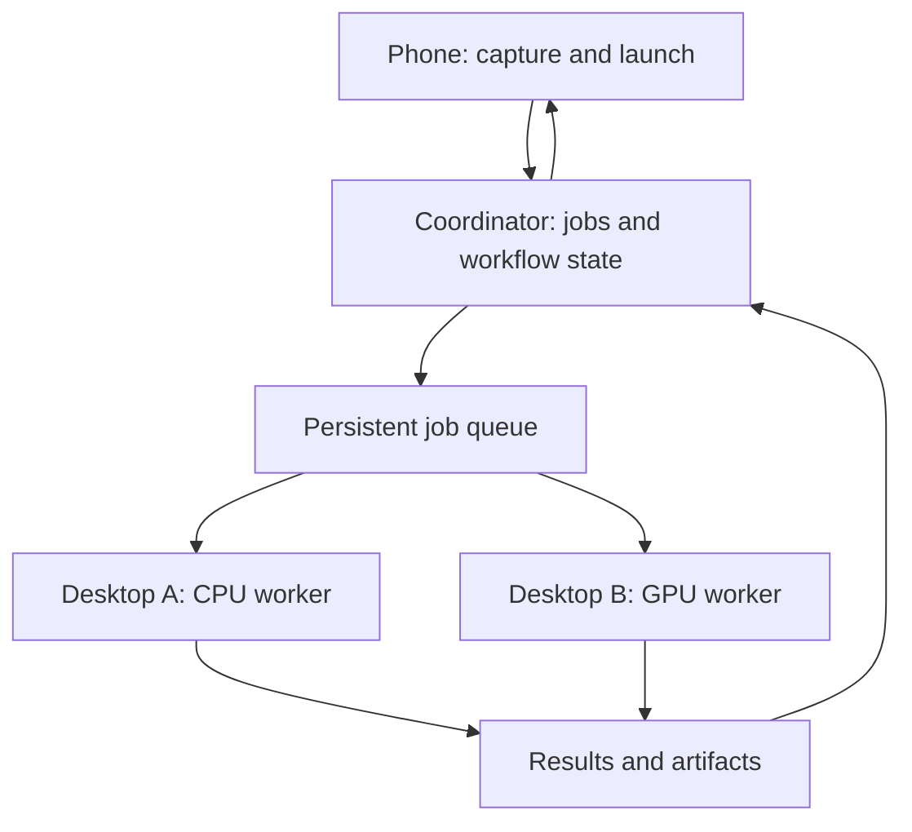

# XBlox Meshing

## Compute

Yes—**XBlox could become a personal compute network:** the phone captures inputs and launches workflows; available desktops execute heavier blocks; results return to the phone.

The important distinction is between **connecting machines, delivering jobs, and coordinating execution**. Different protocols solve different parts.

**What “phone → many” could mean**

| Pattern | XBlox example | Execution behavior |
|---|---|---|
| **Offload** | Phone recording → desktop transcription | Run on one selected machine |
| **Worker pool** | Process 200 photos across three desktops | Each item goes to one available worker |
| **Fan-out / gather** | Ask three models, compare their answers | Create separate jobs and collect results |
| **Pipeline** | Phone capture → desktop OCR → GPU server LLM → phone speech | Different stages run on different machines |
| **Broadcast** | Start a presentation on several displays | Each selected device receives its own command |
| **Failover** | Preferred desktop unavailable → another compatible worker | Reassign eligible work according to policy |

For a first version, I’d prioritize **offload, worker pools and fan-out/gather**. They fit your existing block model naturally.

**Protocols and standards worth considering**

| Technology | What it provides | Where I’d use it |
|---|---|---|
| **HTTPS + JSON** | Simple application API | Submit jobs, check status, retrieve results; easiest starting point |
| **gRPC + Protobuf** | Typed interfaces and bidirectional streaming | Native XBlox runtime communication and progress streams |
| **MQTT 5** | Lightweight publish/subscribe messaging | Device events, telemetry, triggers and IoT integration |
| **NATS + JetStream** | Messaging plus persistent delivery and shared consumers | Durable job queues and multiple desktop workers |
| **WebRTC** | Peer-to-peer audio, video and data connections | Live phone camera/audio feeding desktop processing |
| **CloudEvents** | Standard event envelope | Consistent `job.started`, `job.progress`, `job.completed` events |

gRPC supports unary and streaming calls. MQTT is an OASIS messaging standard. JetStream adds persistence and acknowledged delivery to NATS; multiple clients can share a consumer to divide work. **None of these alone provides XBlox’s complete job scheduler.** [gRPC](https://grpc.io/docs/what-is-grpc/core-concepts/?utm_source=chatgpt.com)

WebRTC requires signaling and connectivity negotiation, with STUN/TURN infrastructure where needed. CloudEvents standardizes event representation rather than execution. [webrtc.org](https://webrtc.org/getting-started/peer-connections?utm_source=chatgpt.com)

**My preferred architecture for XBlox**

Have a **coordinator on a desktop or server**, with a small XBlox worker on each execution machine. The phone submits a job and can disconnect; execution state belongs to the coordinator.

Workers advertise capabilities such as:

- Supported blocks and runtime version.
- Available models, GPU memory and execution slots.
- Operating system and permitted local resources.
- Current availability.

The coordinator chooses a compatible worker. **Send a whole subflow remotely where practical**, rather than paying a network round trip for every tiny block.

For multimedia, keep **job messages small**: identifiers, parameters and file references. Transfer audio, images and video separately, with checksums and resumable downloads.

**Existing projects to inspect**

| Project | Why it matters | Fit for XBlox |
|---|---|---|
| **[NATS / JetStream](https://docs.nats.io/concepts/jetstream)** | Persistent queues, acknowledgments, redelivery and worker sharing | My first investigation for multi-desktop job distribution |
| **[Temporal](https://docs.temporal.io/tasks)** | Durable workflow state, timers and worker task queues | Worth evaluating when workflows must survive failures and long waits |
| **[Ray](https://docs.ray.io/en/latest/ray-core/tasks.html)** | Parallel remote functions and distributed computation | Useful as a backend for Python-heavy AI/data workloads |
| **[KDE Connect](https://kdeconnect.kde.org/)** | Phone/desktop file exchange and remote commands | Good reference for companion-device UX |

Temporal keeps execution history in its service while your workers execute code. Ray provides asynchronous remote tasks, but its documentation labels Windows multi-node support experimental and untested—relevant to your Windows desktop base. KDE Connect demonstrates useful device interactions, rather than a distributed job scheduler. [GitHub](https://github.com/temporalio/documentation/blob/main/docs/encyclopedia/architecture/how-temporal-works.mdx?utm_source=chatgpt.com)

**Connecting devices outside the home network**

For a prototype, **[Tailscale](https://tailscale.com/docs/concepts/wireguard)** is a practical way to connect your own phones and desktops: it builds on WireGuard and adds NAT traversal and access controls. This handles connectivity; XBlox still needs application authentication and job permissions. [Tailscale Docs](https://tailscale.com/docs/concepts/wireguard?utm_source=chatgpt.com)

For an integrated consumer experience, I’d consider a reachable coordinator/relay with **outbound connections from desktops**. That avoids asking users to configure router ports. Local connections can remain an optimization.

**The execution contract matters more than the transport**

Define these once, independently of whether you use HTTP, gRPC or NATS:

- **Identity:** job ID, parent workflow ID, pinned workflow version.
- **Placement:** specific device, device group, or required capabilities.
- **Lifecycle:** queued, running, waiting, completed, failed, cancellation requested.
- **Recovery:** worker leases, heartbeats, timeouts and retry policy.
- **Results:** structured output plus artifact references.
- **Authorization:** which workflows and resources each paired device may use.

Most importantly: **a redelivered job must not accidentally repeat an external action.** Message-delivery guarantees do not guarantee that a payment, upload or sent message executes exactly once. Use idempotency keys where supported, and explicit recovery rules elsewhere.

**How this could appear in the editor**

Suggested new blocks:

| Block | Purpose |
|---|---|
| `Run on device` | Execute a subflow on a named machine |
| `Run on pool` | Choose an available compatible worker |
| `Parallel map` | Distribute independent items with a concurrency limit |
| `Gather results` | Wait for all, a minimum number, or a deadline |
| `Transfer artifact` | Move required media/files |
| `Await remote job` | Resume from a durable job handle |
| `Cancel remote job` | Request cancellation and track acknowledgment |

MCP can provide an additional interface so an agent can discover and invoke XBlox tools. I’d keep scheduling, worker selection and recovery in the XBlox execution layer. MCP’s core role is connecting AI applications to tools and context. [GitHub](https://github.com/modelcontextprotocol/docs/blob/main/docs/concepts/architecture.mdx?utm_source=chatgpt.com)

**I’d prototype this in two steps:** first, phone → one desktop using HTTPS, durable job IDs and artifact transfer; then add NATS/JetStream and multiple workers. The first convincing demo would be **“select 100 photos on the phone → distribute OCR across available desktops → return one searchable report,”** with the job continuing after the phone disconnects.

## Networks

**For XBlox: Wi-Fi carries compute jobs and media; Bluetooth connects nearby devices; LoRa carries small commands and sensor events over longer distances.** Here, LoRa means the radio technology.

| Property | LoRa / LoRaWAN | Wi-Fi | Bluetooth |
|---|---|---|---|
| **Primary strength** | Long range, low power | High throughput, IP networking | Nearby peripherals and low-power interaction |
| **Indicative range** | Kilometres in suitable conditions | Room/building; longer with suitable equipment | Room-scale typically; extended range depends on hardware/PHY |
| **Data capacity** | Small, infrequent messages | Large files, audio/video, continuous streams | Small messages and moderate transfers; audio through supported profiles |
| **Power profile** | Very low for infrequent transmissions | Higher during active transfers | BLE is well suited to low-duty-cycle devices |
| **Phone hardware** | Usually needs an external radio | Normally built in | Normally built in |
| **Infrastructure** | LoRaWAN gateway/server, or a separate peer/mesh protocol | Access point, hotspot, or Wi-Fi Direct | Direct connections; optional mesh infrastructure |
| **Internet required?** | No; depends on deployment | No for local communication | No |
| **XBlox role** | Remote triggers, telemetry, short status responses | Main distributed-computing connection | Pairing, sensors, controls and nearby triggers |
| **Main limitation** | Very limited throughput and airtime | Coverage, power and network availability | Throughput, range and device/profile compatibility |

Ranges are planning guidance, not guarantees. LoRaWAN commonly quotes approximately **0.3–50 kb/s**, depending on configuration. BLE PHY rates include **125/500 kb/s and 1/2 Mb/s**; application throughput is lower. Wi-Fi throughput varies substantially by generation and deployment. [LoRa Alliance®](https://lora-alliance.org/about-lorawan-old/?utm_source=chatgpt.com)

**Standards and protocols**

| Technology / mode | Topology and protocol | XBlox integration |
|---|---|---|
| **LoRa radio** | Radio layer; application must supply addressing and message behavior | Compact custom commands through a radio adapter |
| **LoRaWAN** | Devices → gateways → network server; typically star-of-stars | Network-server integration → MQTT → XBlox trigger |
| **Meshtastic over LoRa** | Mesh messaging; distinct from LoRaWAN | Phone → Bluetooth/USB/Wi-Fi radio → mesh → remote bridge |
| **Wi-Fi LAN / hotspot** | Normal IP networking | HTTPS, gRPC, WebSocket, MQTT or NATS |
| **Wi-Fi Direct** | Direct connection without an access point, on supported devices | Local job/file transfer using an IP application protocol |
| **Bluetooth LE** | GATT services/characteristics, notifications and advertising | Sensor readings, discovery, commands and status |
| **Bluetooth Classic** | Profile-based connections, including audio and RFCOMM where supported | Accessories, audio and custom serial-style links |
| **Bluetooth Mesh** | Separate mesh networking model | Building/device control; not the default compute transport |

LoRaWAN gateways bridge radio traffic to an IP-connected network server. Meshtastic instead provides its own LoRa mesh and lets phones/computers connect through Bluetooth, Wi-Fi or USB. Android Wi-Fi Direct supports direct high-throughput communication without internet access. [lora-alliance.org](https://lora-alliance.org/wp-content/uploads/2020/11/lorawan1.0.3.pdf?utm_source=chatgpt.com)

**Fit for distributed XBlox workflows**

| Workflow | LoRa | Wi-Fi | Bluetooth |
|---|---|---|---|
| Start an already-installed desktop workflow | Good for compact command via bridge | Excellent | Good nearby |
| Return progress / completion | Short, infrequent status only | Excellent | Good |
| Upload photos for OCR | Poor fit | Excellent | Possible, slower |
| Stream microphone/camera to desktop AI | Unsuitable for general media streaming | Best choice | Audio depends on profile; poor for video |
| Distribute hundreds of files across desktops | Unsuitable | Best choice | Poor fit |
| Collect battery-powered sensor events | Excellent over distance | Good where power/network exist | Excellent nearby |
| Phone → many compute workers | Trigger gateway; dispatch over IP | Coordinator and worker pool | Prefer a nearby gateway |
| Operate without internet | Yes, with local radio infrastructure | Yes, over LAN/hotspot/direct | Yes, nearby |
| Send models or workflow asset bundles | Unsuitable | Best choice | Small bundles only |

These are architecture recommendations: the radio transports data; the XBlox coordinator still handles scheduling, retries and worker selection.

**Projects and implementation priorities**

| Area | Project / reference | What to use or study | Priority |
|---|---|---|---|
| LoRa mesh | [Meshtastic](https://meshtastic.org/docs/introduction/) | Off-grid commands, telemetry and phone-to-radio integration | Optional extension |
| LoRaWAN | [ChirpStack](https://www.chirpstack.io/docs/) | Open-source network server with MQTT integration and gRPC API | For sensor/industrial deployments |
| Wi-Fi compute | [NATS / JetStream](https://docs.nats.io/concepts/jetstream) | Persistent job distribution over IP | After basic remote execution |
| Wi-Fi without router | [Android Wi-Fi Direct](https://developer.android.com/develop/connectivity/wifi/wifip2p) | Nearby discovery and direct transfers | Second phase |
| Bluetooth | [Bluetooth LE reference](https://www.bluetooth.com/bluetooth-le-primer/) | GATT-based device integration and notifications | Early for peripherals |

ChirpStack exposes device events over MQTT and accepts downlink requests; JetStream supplies persistent messaging and shared consumers for distributing work. [chirpstack.io](https://www.chirpstack.io/docs/?utm_source=chatgpt.com)

**Recommended combination:** Wi-Fi for execution and artifacts, BLE for nearby peripherals, and an optional LoRa bridge for remote events. Over LoRa, send **“run workflow 17 with these small parameters”** and return a short result; keep models, media and substantial computation at the destination.

## Storage

**Yes—there is enough existing infrastructure. I’d reuse a P2P transfer engine and build XBlox’s permissions, artifact catalog and execution rules around it.**

For “mesh,” distinguish **peers sharing files over existing networks** from **devices forwarding radio traffic**. The projects below primarily provide the former.

| Project | What it already solves | Best XBlox use | Main consideration |
|---|---|---|---|
| **[Syncthing](https://syncthing.net/)** | Continuous folder synchronization, block exchange, device identity, discovery and relay fallback | Keep workflow folders, inputs and results synchronized between trusted devices | Folder synchronization semantics may be too broad for individual job artifacts |
| **[Iroh](https://www.iroh.computer/)** + **iroh-blobs** | Encrypted P2P connections; separate protocol for resumable, verifiable blob transfer | Embed artifact transfer directly inside XBlox | Core bindings exist; higher-level blob integration needs additional work |
| **[IPFS](https://docs.ipfs.tech/concepts/how-ipfs-works/)** | Content-addressed files, peer discovery and block exchange | Retrieve an artifact by hash from peers holding it | Requires deliberate persistence, access and privacy design |
| **[libtorrent](https://libtorrent.org/features.html)** | BitTorrent swarming, piece verification, resume and peer discovery | Distribute large models or media bundles to many desktops | Add your own trusted-device authorization and catalog |
| **[LocalSend](https://github.com/localsend/protocol)** | Local discovery and direct file transfer using a documented REST protocol | “Send to nearby device” | Local transfer protocol, not a replicated mesh storage system |

Syncthing exchanges missing blocks between devices and supports encrypted relay fallback. IPFS Bitswap retrieves content-addressed blocks from peers. libtorrent provides mature swarming and resume capabilities. [Syncthing documentation](https://docs.syncthing.net/specs/bep-v1.html?utm_source=chatgpt.com)

**Which one matches your intended behavior?**

| Desired behavior | First candidate |
|---|---|
| “Keep these folders available on my devices” | **Syncthing** |
| “XBlox silently fetches the inputs needed for this job” | **Iroh + blobs** |
| “Any authorized peer holding this artifact can supply it” | **Iroh with a provider catalog**, or **IPFS** |
| “Distribute a 20 GB model to 30 machines efficiently” | **libtorrent** |
| “Send these photos to the nearby desktop” | **LocalSend** |
| “Original phone goes offline; other devices continue sharing” | Any replication/swarming approach **after enough data has reached other peers** |

**Two integration details matter for Android:**

- **Iroh:** official Kotlin/Android bindings are available, alongside desktop support. However, the current FFI explicitly excludes `iroh-blobs`, `iroh-docs` and `iroh-gossip`; don’t assume the complete file-sharing layer is exposed through Kotlin. [GitHub](https://github.com/n0-computer/iroh-ffi?utm_source=chatgpt.com)
- **Syncthing:** the original official Android wrapper was discontinued and archived in December 2024. Its engine remains a candidate, but Android packaging and lifecycle support need a separately evaluated solution. [GitHub](https://github.com/syncthing/syncthing-android?utm_source=chatgpt.com)

**For XBlox, I’d shortlist Iroh and Syncthing**

| Approach | What you reuse | What XBlox adds |
|---|---|---|
| **Fast prototype: Syncthing companion** | Folder replication and networking | Pairing UX, watched artifact folders, job submission and completion tracking |
| **Integrated product: Iroh + blobs** | P2P connectivity and verified transfer | Artifact catalog, authorized providers, replication policy, retention and job integration |

A useful artifact model would be:

| Field / policy | Purpose |
|---|---|
| `contentHash` | Identify exact bytes and verify transfers |
| `size`, `mediaType` | Plan transfers and select compatible blocks |
| `providers` | Know which authorized devices hold a copy |
| `replicas` | Keep selected artifacts on more than one desktop |
| `retention` | Separate temporary job inputs from retained results/models |
| `access` | Control which peers may fetch or redistribute |
| `availability` | Show “available”, “partial”, or “waiting for a peer” |

**A relay is not a stored copy:** forwarding traffic does not make a file available after its source disappears. For phone-originated work, confirm that an assigned desktop has the input before showing “safe to disconnect.”

For private documents, public IPFS also needs care: transport encryption does not encrypt stored content, and public discovery exposes provider/content metadata. Content encryption and restricted sharing must be designed explicitly. [IPFS Docs](https://docs.ipfs.tech/concepts/privacy-and-encryption/?utm_source=chatgpt.com)

My recommendation: **prototype with Syncthing to prove the workflow; evaluate Iroh for the embedded implementation.** Add BitTorrent only if distributing large shared models becomes a major requirement.
